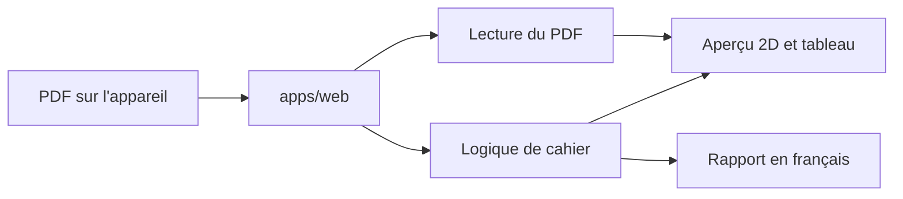

# Printelle

Printelle montre un cahier agrafé avant l'impression et dit si l'ordre des pages est bon. Il s'adresse aux associations, écoles et petites structures qui envoient un PDF, et aux imprimeurs qui le reçoivent.

> **Principe fondamental :** l'outil signale et explique ; il ne décide pas à la place de l'utilisateur, et il ne promet que ce qu'il a réellement contrôlé.

En V1, le PDF reste sur l'appareil. Il n'y a ni compte, ni paiement, ni envoi du fichier à un serveur.

## Ce que fait la V1

- Lire un PDF (nombre de pages, format, pages simples ou vis-à-vis) et demander confirmation en cas de doute, par exemple A4 paysage ou A5 en vis-à-vis.
- Calculer les feuilles recto/verso d'un cahier agrafé. Pour 16 pages, la feuille 2 donne 14 | 3 et 4 | 13, et chaque paire somme à 17.
- Signaler un nombre de pages qui n'est pas un multiple de 4, des pages blanches et une numérotation absente ou illisible.
- Afficher un aperçu 2D feuilletable et un tableau feuille par feuille.
- Produire un rapport en français qui nomme le montage choisi et ce qui n'a pas été contrôlé.

La V1 ne modifie pas le PDF, ne fait pas de mise en page et ne contrôle ni les couleurs ni l'encre. L'aperçu 3D, les comptes, le lien de validation et le paiement viennent après.

Le détail des versions est dans le [cahier des charges](docs/cdc/2026-10-19-cahier-des-charges.md).

## Démarrer

Le dépôt contient aujourd'hui les règles, la documentation et un PDF de test. L'application Next.js (`apps/web`) n'est pas encore créée.

- **Règles du dépôt** : [`CONTRIBUTING.md`](CONTRIBUTING.md).
- **Nouveau sur le projet ?** [`docs/guides/demarrage-developpeur.md`](docs/guides/demarrage-developpeur.md).
- **Où est quoi** : [`docs/README.md`](docs/README.md).
- **Cahier des charges** : [`docs/cdc/2026-10-19-cahier-des-charges.md`](docs/cdc/2026-10-19-cahier-des-charges.md).
- **PDF de test** : [`tests/pdf/apecd-16-vis-a-vis.pdf`](tests/pdf/apecd-16-vis-a-vis.pdf) (cahier APECD, 16 pages, vis-à-vis).

```bash
make hooks   # une fois par clone (obligatoire)
make setup   # installe les dépendances des applications initialisées
make check   # secrets + lint + analyse statique + architecture + tests
make help    # toutes les commandes
```

Dépôt : [github.com/AresGn/printelle](https://github.com/AresGn/printelle).

## Architecture

Une seule application est déclarée dans `.kit.conf` : `apps/web` (Next.js, TypeScript). La logique de cahier (paires recto/verso, format, contrôles) reste séparée de l'interface, pour pouvoir ajouter plus tard un aperçu ou une API sans la réécrire.



## Standards de développement et décisions

- [`AGENTS.md`](AGENTS.md) : invariants métier, architecture et seuils de code.
- [`CONTRIBUTING.md`](CONTRIBUTING.md) : flux de travail, contrôles, CI locale, relecture.
- [`apps/web/CODING.md`](apps/web/CODING.md) : où va le code de l'application web.
- [`docs/README.md`](docs/README.md) : index de la documentation.
- [`docs/policies/securite.md`](docs/policies/securite.md) : règles de sécurité.
- [`docs/adr/`](docs/adr) : registre des décisions d'architecture.
- [`.github/pull_request_template.md`](.github/pull_request_template.md) : checklist avant validation d'une PR.

## Reporté

Ces briques sont décrites dans le cahier des charges. Elles ne font pas partie de la V1.

| Brique | Reportée à | Condition pour la retenir |
|---|---|---|
| Three.js (aperçu 3D) | V2 | La V1 est utilisée par des imprimeurs, et l'aperçu reste fluide sur téléphone. |
| Comptes, lien de validation, PostgreSQL, stockage de fichiers | V2 | Le fichier doit quitter l'appareil, avec suppression automatique et lien non devinable. |
| Python, FastAPI, analyse poussée du PDF | V3 | Un avis a confirmé que les bibliothèques choisies sont compatibles avec Apache 2.0. Ghostscript et PyMuPDF, sous AGPL, ne sont pas retenus sans cet avis. |
| Mobile Money (KKiaPay ou FedaPay) | Après la V1 gratuite | Le prix a été testé auprès d'imprimeurs. |
| Vue/Nuxt, SvelteKit | — | Next.js et TypeScript sont le choix de travail. Un autre framework demanderait un ADR. |

## Licence

Copyright 2026 Arès GNIMAGNON.

Projet personnel, open source, sous [licence Apache 2.0](LICENSE).
