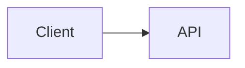

# Printelle

<!-- À REMPLIR: une phrase qui dit ce que fait le produit et pour qui. -->

> **Principe fondamental :** <!-- À REMPLIR: le principe qui ne se négocie pas (ex. « l'application assiste, elle ne décide pas »). -->

## Démarrer

- **Règles du dépôt** : [`CONTRIBUTING.md`](CONTRIBUTING.md) (flux de travail, hooks, protection de la branche, relecture).
- **Nouveau sur le projet ?** Lire d'abord [`docs/guides/demarrage-developpeur.md`](docs/guides/demarrage-developpeur.md) : prérequis, initialisation de chaque application.
- **Où est quoi** : [`docs/README.md`](docs/README.md). **Qui a quel ticket** : [`docs/backlog.md`](docs/backlog.md).

```bash
make hooks   # une fois par clone (obligatoire)
make setup   # installe les dépendances des applications initialisées
make check   # secrets + lint + analyse statique + architecture + tests
make help    # toutes les commandes
```

## Architecture

<!-- À REMPLIR: schéma des applications (ou lien), en Mermaid. Applications déclarées dans .kit.conf :

-->

## Standards de développement et décisions

- [`AGENTS.md`](AGENTS.md) : invariants métier, architecture et seuils de code (lu à chaque session d'agent).
- [`CONTRIBUTING.md`](CONTRIBUTING.md) : flux de travail, contrôles, CI locale, relecture.
- Écrire du code dans une application : le `CODING.md` de chaque application (chemins dans `.kit.conf`).
- [`docs/README.md`](docs/README.md) : index de la documentation (où est quoi, qui la met à jour, règles de maintenance).
- [`docs/policies/securite.md`](docs/policies/securite.md) : règles de sécurité par conception.
- [`docs/adr/`](docs/adr) : registre des décisions d'architecture.
- [`.github/pull_request_template.md`](.github/pull_request_template.md) : checklist obligatoire avant toute validation de PR.

## Outils à réévaluer plus tard

<!-- À REMPLIR: les outils envisagés mais non adoptés, avec la raison et le critère qui ferait changer d'avis.
Exemple : « Graphify (graphe de connaissances du dépôt) : pas adopté, le dépôt est presque tout documentation ;
à réévaluer quand plusieurs modules de code seront livrés. » -->

Ce projet a été initialisé avec l'**Agentic Kit SINDA SARL** (version dans `.kit-version`). Les règles communes y sont décrites et justifiées ; leurs adaptations à ce projet sont dans `AGENTS.md` et `CONTRIBUTING.md`.
