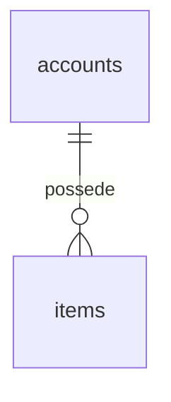

# Design 0002 : Base de données

- **Statut** : brouillon | prototype validé le AAAA-MM-JJ
- **Sources** : PRD, design système, ADR de la base de données
- **Règle** : la structure verrouille ce qu'un défaut de code ne doit jamais pouvoir faire (états illégaux, doublons, accès hors périmètre).

## 1. Principes

1. **Un schéma par module, aucune clé étrangère entre schémas.** Une référence vers un autre module est une colonne « souple », vérifiée par le cas d'usage et contrôlée par un job.
2. **Conventions** de `AGENTS.md` (clé primaire, horodatages avec fuseau, types, clés étrangères avec action explicite, tables de jonction à clé composite).
3. Tables append-only (journal, historique de transitions) : aucun `UPDATE` ni `DELETE` pour le rôle applicatif, barrières par triggers.
4. Exceptions aux conventions : listées et justifiées (tables du framework, tables de référence).

## 2. Schémas et rôles

| Schéma | Module | Contenu |
|---|---|---|

| Rôle | Droits | Utilisé par |
|---|---|---|
| `<projet>_owner` | propriétaire des objets, DDL | migrations uniquement |
| `<projet>_app` | DML sur les schémas des modules, sauf tables append-only | l'application |
| `<projet>_audit_reader` | lecture du journal | la route d'audit |
| `<projet>_public_ro` | lecture d'une seule vue publique | la lecture publique |
| `<projet>_jobs` | purge et contrôles | les tâches planifiées |

Règles de configuration : `REVOKE ALL … FROM PUBLIC`, droits ciblés, `ALTER DEFAULT PRIVILEGES` par schéma, aucune requête applicative sous le rôle propriétaire. Le provisionnement (rôles, schémas, extensions) est un script d'initialisation, hors migrations applicatives.

## 3. Données personnelles et chiffrement

| Classe | Colonnes | Traitement |
|---|---|---|
| Sensible | identifiant national, nom, téléphone, tout texte libre saisi par une personne | chiffré au repos par l'application (AEAD avec donnée associée = schéma, table, colonne, identifiant de ligne), jamais journalisé |
| Sensible en clair par exception | position exacte, si nécessaire à un index | décision documentée et risques assumés |
| Publique | texte validé pour le public | en clair, par nature |

Empreinte (HMAC) pour l'unicité sans déchiffrer, avec une clé distincte ; versions de clé sur chaque table concernée ; mots de passe en argon2id.

## 4. Modèle par module

Un tableau par module : table, colonnes principales, contraintes (unique, CHECK, triggers).

## 5. Machines à états portées par la base

Tables de transitions autorisées semées depuis le PRD ; triggers qui refusent une transition absente, exigent la ligne de transition de la même transaction, et verrouillent les indicateurs monotones.

## 6. Cloisonnement en base

La requête de liste (forme, index, pagination par curseur), la concurrence (verrous triés), la performance (test avec un volume réaliste avant d'accepter le plan).

## 7. Journal d'audit append-only

Colonnes, écriture par une fonction unique, quoi tracer, lecture par un rôle dédié, résumés par tranches publiés hors de la base.

## 8. Requêtes et index critiques

## 9. Conservation et effacement

Classes de conservation, procédure de purge unique (ordre de verrouillage, objets de stockage d'abord), pseudonymisation d'un compte, sauvegardes.

## 10. Références souples et intégrité

Contrôles à l'écriture et job quotidien d'intégrité.

## 11. Décisions à prendre et points ouverts

## 12. Schéma des relations

## 13. Tests de schéma obligatoires

Chaque test est un défaut bloquant s'il manque. Numéroter : les tickets de migration citent ces numéros.
